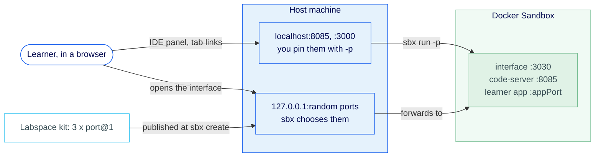

# Labspace on Docker Sandboxes

Run a [Labspace](https://github.com/dockersamples/labspace-infra) (instructions on the left, VS Code on the right, Docker available to the learner) with `sbx run` instead of a six-container `docker compose up`. See [docs/architecture.md](docs/architecture.md) for diagrams of both setups.

## Kits

This repository publishes three kits to GitHub Container Registry. Each has its own README with its run command and the ports to pin:

| Kit | Package | README |
|---|---|---|
| Labspace runtime: the interface, VS Code and a private Docker engine | `ghcr.io/mathieu-benoit/labsbxes/labspace` | [kit/README.md](kit/README.md) |
| Hello Labspace: a minimal lab (content kit) | `ghcr.io/mathieu-benoit/labsbxes/hello-lab` | [examples/hello-lab/README.md](examples/hello-lab/README.md) |
| Building Container Images: Best Practices (content kit) | `ghcr.io/mathieu-benoit/labsbxes/building-images-lab` | [examples/building-images-lab/README.md](examples/building-images-lab/README.md) |

A content kit always runs with the Labspace kit. Commands for all three are in [Published kits](#published-kits-github-actions).

## Run from source

The infrastructure is a single [Sandbox Kit](https://github.com/docker/sandbox-kit-spec) (v3 mixin) that layers onto the built-in `shell` agent.

```bash
sbx run shell --kit ./kit -p 8085:8085 -p 3000:3000 --name my-lab ./examples/hello-lab
sbx ports my-lab
```

Then open the interface: `http://127.0.0.1:<HOST PORT>/`, with the host port `sbx ports` lists for sandbox port 3030.

- `./examples/hello-lab` is the **content repo**, mounted as the sandbox workspace. It has the same layout as any labspace-infra content repo: `labspace/` (`labspace.yaml` + markdown) and `project/` (what the IDE opens).
- The kit publishes its ports itself (see [Ports](#ports-published-by-the-kit-or-pinned-by-you)). `-p` only pins a host port where something expects a fixed `localhost` address:
  - `-p 8085:8085` is required: the interface embeds the IDE at `http://localhost:8085`.
  - `-p 3000:3000` is for hello-lab's tab link to `http://localhost:3000`. A lab with no such link doesn't need it.
  - `-p 3030:3030` is optional: add it to always open the interface at http://localhost:3030.
- If host port 8085 is already taken (for example by a running Compose Labspace), the IDE panel won't load: only one lab at a time can use it.
- The command attaches you to a bash session in the sandbox. Add `-d` to start it detached; the kit declares `long-running@1`, so the lab keeps running either way.
- Re-attach with `sbx run --name my-lab`, stop with `sbx stop my-lab`, throw everything away with `sbx rm my-lab`.

### Ports: published by the kit, or pinned by you

The kit declares the ports the sandbox serves with the [`port@1`](https://github.com/docker/sandbox-kit-spec/blob/main/docs/spec/capabilities/com.docker.sandbox/port%401.md) capability (3030, 8085 and `appPort`), so they are published as soon as the sandbox is created, with no `sbx ports` command. A kit only names the **sandbox** port. The **host** port is chosen by `sbx`: a free one on `127.0.0.1`, chosen again at every start. The spec forbids a kit from pinning it, so that two shared kits can't ask for the same one. When the host port matters, you pin it yourself with `-p` (or `sbx ports --publish`).



`sbx ports my-lab` lists what `sbx` picked (for example `127.0.0.1:60036 -> 3030`). The interface works from there, but its IDE panel loads `http://localhost:8085`, a fixed address, which is why every command here pins 8085. Without it the panel stays blank.

### Without any content

Launching the kit with no lab (an empty folder, no content kit) does not fail. It shows a **built-in getting-started lab**: what happened, the folder it looked in, and the three ways to give the sandbox a lab (a local folder, a content kit, a set), with a "Save" scaffold that writes a starter lab (`labspace/`, `project/`, and the two content-kit files) into the IDE. Copy it out with `sbx cp <sandbox>:/home/agent/project/my-lab ./my-lab`, then run it with `--kit ./kit --kit ./my-lab`. The content is in [kit/files/opt/labspace/default-content](kit/files/opt/labspace/default-content).

The lab is chosen at every boot, first match wins: the workspace's `labspace/labspace.yaml`, then a content kit, then the built-in lab.

## Packaging a lab as a kit (one reference)

Running a lab from a workspace folder is for authoring and demos. To hand a lab to someone, package its content as a second kit. It carries only the two folders and composes with the Labspace kit:

```bash
# from the repo root; the lab content comes from the kit, not from the workspace
sbx run shell --kit ./kit --kit ./examples/hello-lab -p 8085:8085 -p 3000:3000 --name hello-lab
```

[examples/hello-lab](examples/hello-lab) is both a content repo and a content kit: [hello-lab.yaml](examples/hello-lab/hello-lab.yaml) (a mixin that `requires` the Labspace kit and `provides` `labspace-content`) and [hello-lab.dockerfile](examples/hello-lab/hello-lab.dockerfile) (`FROM scratch`, copies `labspace/` and `project/` to `/opt/labspace/content`). To make your own lab a kit, add those two files to its repo, adjusting the name and version. If the lab runs an app the learner opens, declare its port in the content kit with `port@1`, as hello-lab does for 3000: the lab then publishes what it needs whatever `appPort` is set to, and two kits declaring the same port are a single publication.

When the content comes from a kit, the instructions are read from the kit, and `project/` is copied once to `~/project` in the sandbox, which is what the IDE opens. The learner's edits stay in the sandbox and survive `sbx stop`/`sbx run`; they are not written to the host. If the workspace itself contains a `labspace/labspace.yaml`, that wins over the kit, which is what makes authoring against a published kit possible.

The resolver enforces the pairing: the content kit alone fails with `requires "labspace >= 0.1.0" but nothing in the set provides it`, and two content kits conflict because both provide `labspace-content`.

### Giving the pair a single reference

A `kind: set` merges the two into one published kit. Publish both kits to a registry, then publish the set that lists them (set members must be registry references; local paths are refused):

```yaml
# hello-lab-set.yaml
# syntax=docker/sandbox-kit:3
schemaVersion: "3"
kind: set
displayName: Hello Labspace (ready to run)
version: "0.1.5"
kits:
  - ref: docker.io/<you>/labspace:0.1.5
  - ref: docker.io/<you>/hello-lab:0.1.5
```

```bash
docker buildx build --builder kit-builder kit -f kit/labspace.yaml -t docker.io/<you>/labspace:0.1.5 --push
docker buildx build --builder kit-builder examples/hello-lab -f examples/hello-lab/hello-lab.yaml -t docker.io/<you>/hello-lab:0.1.5 --push
docker buildx build --builder kit-builder . -f hello-lab-set.yaml -t docker.io/<you>/hello-lab-set:0.1.5 --push

# learners:
sbx run shell --kit docker.io/<you>/hello-lab-set:0.1.5 -p 8085:8085 -p 3000:3000 --name hello-lab
```

`kit-builder` is a `docker-container` builder (`docker buildx create --name kit-builder --driver docker-container --bootstrap`), as in the [spec README](https://github.com/docker/sandbox-kit-spec#building-a-kit).

The published set is one ordinary mixin that pins both members by digest and carries the merged capabilities and hooks. By default `sbx` only installs kits from `docker.io/` and `dhi.io/` (`kit.allowedSources`).

## Published kits (GitHub Actions)

[.github/workflows/publish-kits.yaml](.github/workflows/publish-kits.yaml) builds the kits for `linux/amd64` and `linux/arm64` and publishes them to this repository's container registry:

| Kit | Reference | Source |
|---|---|---|
| Labspace runtime | `ghcr.io/mathieu-benoit/labsbxes/labspace` | [kit/](kit) |
| `hello-lab` content | `ghcr.io/mathieu-benoit/labsbxes/hello-lab` | [examples/hello-lab/](examples/hello-lab) |
| `building-images-lab` content | `ghcr.io/mathieu-benoit/labsbxes/building-images-lab` | [examples/building-images-lab/](examples/building-images-lab) |

Run them from a **dedicated, empty folder**. `sbx run` mounts the current folder into the sandbox as its workspace, read-write. Started from your home directory, that would hand the sandbox your SSH keys, cloud and registry credentials, shell history and every other project, which defeats the point of a sandbox. Give it only what the lab needs: with a content kit the lab doesn't use the workspace at all, so an empty folder is enough. (`sbx` also blocks the home directory outright, with `mount "/Users/<you>" overlaps Sandboxes configuration, state or credentials`.)

```bash
mkdir -p ~/sbx-lab && cd ~/sbx-lab
```

Then start one of the labs from that folder.

The built-in getting-started lab (Labspace kit only):

```bash
sbx run shell --kit ghcr.io/mathieu-benoit/labsbxes/labspace:0.1.5 -p 8085:8085 --name labspace
```

`hello-lab` (pin 3000 for its tab link):

```bash
sbx run shell --kit ghcr.io/mathieu-benoit/labsbxes/labspace:0.1.5 --kit ghcr.io/mathieu-benoit/labsbxes/hello-lab:0.1.5 -p 8085:8085 -p 3000:3000 --name hello-lab
```

`building-images-lab` (pin 5050 for its Quote App tab):

```bash
sbx run shell --kit ghcr.io/mathieu-benoit/labsbxes/labspace:0.1.5 --kit ghcr.io/mathieu-benoit/labsbxes/building-images-lab:0.1.5 -p 8085:8085 -p 5050:5050 --name building-images-lab
```

Then open the host port `sbx ports <name>` lists for sandbox port 3030 (for example `sbx ports hello-lab`). That host port is picked by `sbx` and changes at every start; add `-p 3030:3030` to any of these commands to open the interface at http://localhost:3030 instead.

| Event | What it does |
|---|---|
| Pull request | Builds all kits to a local OCI layout and validates them with `kit-tck`; pushes nothing. |
| Push of a `v*` tag | Publishes `:<version from the kit's descriptor>` and `:latest`. A version that already exists is skipped, so a published version is immutable. |
| Manual run (**Actions → publish-kits → Run workflow**) on `main` | Publishes `:edge` and `:sha-<short>`. On any other branch it only builds. |

Commits to `main` don't publish anything on their own.

The kits are versioned **in lockstep**. To release, bump `version:` to the same value in every descriptor (`kit/labspace.yaml`, `examples/hello-lab/hello-lab.yaml`, `examples/building-images-lab/building-images-lab.yaml`), merge, then push the matching tag (`git tag v0.2.0 && git push origin v0.2.0`). The workflow's first job fails the run if the versions differ, or if the tag doesn't name them (`v0.2.0` must mean `0.2.0`). The `v` is only on the git tag; the published image tags have none (`:0.2.0`), as the kit spec requires.

The workflow runs `kit-tck validate` (the specification's conformance checker, pinned and checksum-verified) every time: on pull requests against the built OCI layout, and after each publish against the artifact that actually reached the registry. The descriptors' `sourceUrl` becomes the `org.opencontainers.image.source` annotation, which is what links the packages to this repository.

By default `sbx` only installs kits from `docker.io/` and `dhi.io/` (`kit.allowedSources`). To use these references, allow the namespace:

```bash
sbx settings set kit.allowedSources '["docker.io/","dhi.io/","ghcr.io/mathieu-benoit/"]'
```

New GHCR packages can start out private. After the first publish, check each package's visibility under the repository's **Packages** and make it public if learners should be able to pull it without signing in.

## What changed compared to labspace-infra

[docs/architecture.md](docs/architecture.md) has a diagram of each setup and a side-by-side summary.

| labspace-infra (Compose) | This kit | Why |
|---|---|---|
| `socket-proxy` | **Removed** | The sandbox is a microVM with its own Docker engine (`dockerd@1`). The learner's `docker` never reaches the host engine, so there is nothing to filter, label, allowlist or remap. Bind mounts of the project folder just work, since the engine and the files share a filesystem. |
| `workspace-cleaner` | **Removed** | The engine store lives in the sandbox. `sbx rm` deletes every container, volume, network and image the lab created. |
| `host-port-republisher` | **Removed** | Its job was bridging "container publishes a port" to "localhost on the host". Ports are now published by the runtime (`port@1`, `sbx ports`). |
| `configurator` | **Replaced by two small scripts** | `labspace-init.sh` (once: keypair, dirs) and `labspace-stage.sh` (every boot: copy `labspace/` to the instructions dir, write metadata). No git clone, no tarball, no volumes: the content is the workspace, or a content kit. |
| `interface` | **Kept, unchanged** | Reused from the published `dockersamples/labspace-interface` image, copied into the overlay at build time. The built-in `shell` kit (Debian 13) has no Node, so the overlay also carries the `node` binary from `node:24-bookworm-slim`. |
| `workspace` (code-server) | **Kept, built into the overlay** | Same approach as the `code-server` kit in sbx-kits-contrib: pinned install at build time, no download at create. |
| `support-vscode-extension` | **Kept, unchanged** | Reused from `dockersamples/labspace-support-vscode-extension`. The JWT + unix socket between interface and IDE still works, now between two processes in one sandbox. |
| `marlin-mock` (development stack only) | **Removed** | Analytics are off (`analytics_enabled: false`). |
| 5 named volumes, 1 network, 5 `configs` | **None** | |

Net: the 6 containers and 5 volumes of `compose.run.yaml` become 2 processes (`node`, `code-server`) plus the sandbox's own engine.

## Layout

```
kit/
  labspace.yaml          # descriptor: kind mixin, capabilities, lifecycle hooks
  labspace.dockerfile    # builds the overlay (FROM scratch at the end)
  files/
    opt/labspace/bin/    # labspace-init.sh, labspace-stage.sh, labspace-ide.sh, labspace-ui.sh
    home/agent/.local/share/code-server/User/settings.json
examples/hello-lab/      # a tiny lab: a content repo, and (hello-lab.yaml/.dockerfile) a content kit
examples/building-images-lab/ # dockersamples/labspace-building-images as a content kit (Quote App on 5050)
```

### How a boot goes

1. **Create (once):** `labspace-init.sh` (root) makes `/etc/labspace-support/*` and an ES256 keypair.
2. **Every boot:** the runtime starts the sandbox's Docker engine, then runs the startup hooks in order:
   1. `labspace-stage.sh` picks the content (`<workspace>/labspace/labspace.yaml` if present, else a content kit's `/opt/labspace/content`), warns with the fix and stops if there is neither, stages the instructions, records the project folder in `/labspace/project-dir`, and writes the metadata the interface reads.
   2. `labspace-ide.sh` (background) starts code-server on `:8085`, opened on that project folder.
   3. `labspace-ui.sh` (background) starts the interface on `:3030`.
3. **Run button:** the browser sends a code block index, the interface reads the command from the markdown on disk, signs a 15 s JWT and POSTs it to the extension's unix socket, and the extension types it in the IDE terminal. Unchanged from labspace-infra.

Logs: `sbx exec my-lab -- cat /tmp/labspace-ui.log /tmp/labspace-ide.log`.

## Options

| Arg | Default | Meaning |
|---|---|---|
| `devMode` | `false` | `--kit-arg devMode=true` reads `<workspace>/labspace` live, so editing a markdown file on the host and reloading the page is enough. |
| `appPort` | `3000` | Extra port published for an app the learner runs, on a random host port (`sbx ports <name>`). For lab links such as `:tabLink{href="http://localhost:3000"}` to work, also pin it: `-p 3000:3000`. `--kit-arg appPort=8080` changes the port. |
| `codeServerVersion` | `4.140.0` | Build-time pin. |

Egress is limited to Docker Hub (for image pulls) and the Open VSX marketplace. A lab that needs more declares it in its own network policy (`sbx policy`), or in a content kit.

## Status

Tested with sbx 0.53 on Windows, using `examples/hello-lab`:

| Checked | Result |
|---|---|
| Build through the kit frontend (descriptor validation included) | Pass |
| `sbx run shell --kit ./kit -d ...` creates the sandbox, install hook and 3 startup hooks run | Pass |
| Interface serves the lab (`/api/labspace` returns the title and sections) | Pass |
| code-server answers and opens `<workspace>/project`; support extension activates and creates its socket | Pass |
| Run button path: `POST .../command` → JWT → unix socket → command typed in the IDE terminal | Pass |
| Private Docker engine inside the sandbox (`docker info`) | Pass |
| `port@1` publishing (`appPort` 3000 → ephemeral host port; 3030/8085 pinned with `-p`) | Pass |
| Fresh sandbox with **no `-p`**: 3030, 8085 and 3000 are published at create on ephemeral `127.0.0.1` ports (60023, 60024, 60025), the interface answers on its port, and `sbx stop` then `sbx run --name` gives new ones (60026, 60027, 60028) | Pass |
| The `name` labels set on the `port@1` entries in `sbx ports` | Not shown by sbx 0.53 |
| Only `-p 8085:8085` pinned: the interface opened on its ephemeral port (`127.0.0.1:60036`), the IDE panel loaded from `localhost:8085`, and Run typed the command into the IDE terminal | Pass |
| Content kit declaring its own `port@1` (hello-lab, 3000): `sbx kit inspect` reports `Published: 1 ports`; with `--kit-arg appPort=8080` both 8080 and 3000 are published, and nginx started on 3000 answers on its ephemeral host port; with the default `appPort` the two 3000 entries are one publication | Pass |
| `docker pull` / `docker run -p 3000:80 nginx:alpine` inside the sandbox, reached from the host through the `appPort` binding | Pass |
| IDE embedded in the interface at `localhost:8085` (split view), with Run, Save and the open-file link clicked in the real UI | Pass |
| `devMode=true`: a markdown edit on the host shows up in the interface without a restart | Pass |
| `sbx stop` then `sbx run --name ... -d`: services come back, hooks re-run cleanly, pulled images are still there | Pass |
| Workspace without `labspace/labspace.yaml`: startup warns with the fix, sandbox still starts | Pass |
| Running the same kit twice on one host, ports pinned to non-default values (3031/8086) | Pass for the interface and IDE; the embedded IDE panel only loads on 8085 |
| Infra kit + content kit from an **empty** folder: lab served from the kit, `~/project` seeded, IDE opens it, Docker works | Pass |
| Learner edits in `~/project` survive `sbx stop` / `sbx run --name` (project is copied only once) | Pass |
| Content kit alone is refused at resolution (`requires labspace`) | Pass |
| No content at all: the built-in getting-started lab is served, placeholders filled (workspace path, sandbox name), IDE opens the scratch project, no failed hook | Pass |
| Built-in lab's Save scaffold writes the 5 starter files; `sbx cp` copies them out; the copy runs as a content kit and serves "My lab" | Pass |
| Workspace content still wins over the other two sources | Pass |
| Before the built-in lab: no content meant a failed startup hook, nothing listening and a blank browser | (the reason it exists) |
| `kind: set` built from both kits and pushed to a local registry: merged descriptor is a `mixin`, provides the union, members pinned by digest, 1 install + 3 startup hooks | Pass (descriptor inspected) |
| **Running** the lab from the set reference | **Not tested**: the sandbox runtime refused `localhost:5000/...` because `kit.allowedSources` only allows `docker.io/` and `dhi.io/` |
| Two content kits composed together is refused; content kit baked into the set while the workspace has its own `labspace/` | Not tested |
| macOS / Linux hosts, `--cloud` sandboxes, content bigger than the sample | Not tested |

### Kit network rules and org governance

The kit declares `network-policy@1` (Docker Hub for image pulls, Open VSX for extensions). Under a managed governance policy with default-deny, those rules were **not** applied and `docker pull` failed with `403 Forbidden` from `registry-1.docker.io` (`sbx policy log <name>` shows what was blocked). With governance out of the way, `sbx policy ls` shows them as a `kit`-sourced policy scoped to the sandbox ("managed by a kit; recreated at sandbox create"), and pulls work. If pulls fail on your machine, check `sbx policy log <name>` and `sbx policy ls <name>`.

## Open points

- **One port for everything.** Today the learner must pin `-p 8085:8085` because the interface hard-codes `http://localhost:8085` for the IDE. A gateway (or an `IDE_URL` setting in the interface) serving the IDE under the interface's own port would reduce this to one published port, and could let the kit work with ephemeral ports.
- **Instructions are no longer protected from the learner.** In labspace-infra the interface mounted them read-only. In a sandbox the agent user owns the VM anyway, so this was dropped.
- **A set is a pinned artifact.** Bumping the Labspace kit means republishing every lab set that includes it. Keeping the content kit separate (and composing with `--kit`) avoids that, at the cost of two references.
- **Kit content is not on the host.** With a content kit, the learner's project lives in the sandbox (`~/project`), so it is gone after `sbx rm`. Mount a host folder if it must be kept.
- **The first run still mounts the current directory** as the workspace (the default for `sbx run`). Run from a dedicated, empty folder when using a content kit, never from your home directory: whatever folder you start in is exposed to the sandbox.
- **Pin by digest** the `dockersamples/labspace-interface` and `labspace-support-vscode-extension` base images in `labspace.dockerfile`.
- **Init scripts.** labspace-infra ran `/init-scripts/*` in the configurator. The equivalent here would be running an optional `<workspace>/labspace/init.sh` in the install hook.
- The `ttyd` workspace mode in the interface (`WORKSPACE_TYPE=ttyd`) shows the interface already supports a non-VS-Code terminal backend; not used here.
