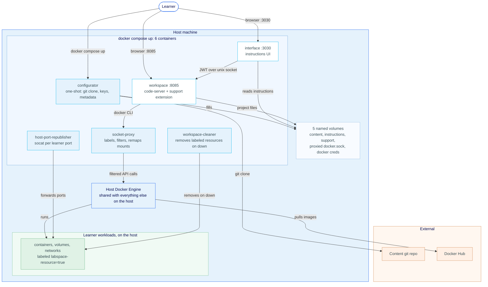
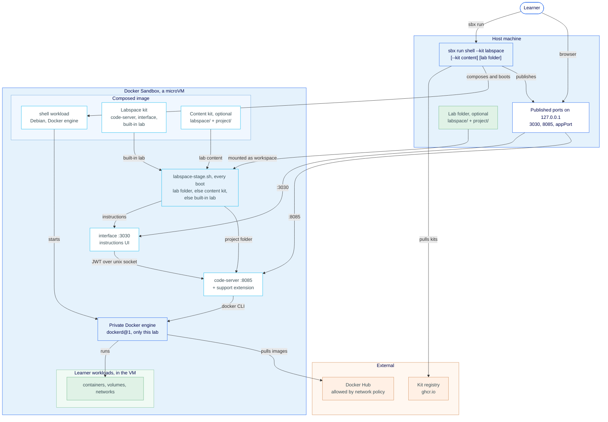

# Architecture: `docker compose up` vs `sbx run`

Both setups give the learner the same thing: instructions on the left, VS Code on the right, and a Docker engine to run the exercises against. What changes is where everything runs and what keeps the learner's Docker usage contained.

## Before: `docker compose up` (labspace-infra)

Six containers share your host's Docker engine. The learner's `docker` commands reach that engine through `socket-proxy`, which labels, filters and remaps every call so the lab only sees, mounts and later deletes its own resources. A separate container republishes learner ports, and another one cleans up on `docker compose down`.

## After: `sbx run` (this repo)

One Docker Sandbox, a microVM, per lab. Its image is composed from kits: the `shell` workload (Debian with Docker), the Labspace kit (code-server, the interface, the scripts and a built-in getting-started lab), and optionally a content kit. The learner's `docker` talks to an engine that only exists inside that VM, so there is nothing to proxy, and `sbx rm` removes everything the lab created.

## The differences at a glance

| | `docker compose up` | `sbx run` |
|---|---|---|
| Isolation boundary | Containers on your host's engine; `socket-proxy` filters the Docker API | A microVM with its own kernel and its own Docker engine |
| Learner's `docker` | Host engine, through the proxied socket | Private engine inside the VM (`dockerd@1`) |
| Where the lab comes from | `configurator` clones a git repo into volumes | A lab folder, a content kit, or the built-in getting-started lab, picked at each boot |
| Ports | 3030 and 8085, plus `host-port-republisher` for learner apps | 3030, 8085 and `appPort` published by the runtime (`port@1`) |
| Network egress | Unrestricted | Allow-list from the kits' network policy |
| Cleanup | `workspace-cleaner` on `docker compose down` | `sbx rm` deletes the VM and its engine store |
| Moving parts | 6 containers, 5 volumes, 1 network, 5 configs | 1 workload kit + the Labspace kit, plus an optional content kit |

Components that disappeared: `socket-proxy`, `workspace-cleaner`, `host-port-republisher`, and the `configurator` container (replaced by two small boot scripts). The interface and the VS Code support extension are reused unchanged from the images labspace-infra publishes.

> [!NOTE]
> This shows `main` today, where the interface and the IDE are published on two ports (3030 and 8085). [#1](https://github.com/mathieu-benoit/labsbxes/pull/1) adds a small gateway that serves both on a single port.
